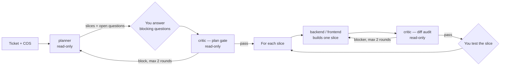

# Claude Code Agent Workflow

**Planner → critic → builder agents for [Claude Code](https://code.claude.com/docs/en/sub-agents) that take a ticket from plan to audited code, one slice at a time — with a human approving every key decision.**

On a real cross-repo feature (backend + web app), the tuned agents finished in **50 minutes and 14.1M tokens**, against **1h 30m and 40.3M tokens** for Claude Code's built-in subagents (~65% fewer tokens). The first version of the same agents failed — what changed is documented in [docs/benchmarks.md](docs/benchmarks.md).

> Full write-up: [How I built a centralized agentic workflow using Claude Code subagents](https://community.7edge.com/t/claude-code-subagents-how-i-built-a-centralized-agentic-workflow-using-subagents/400)

---

## How it works



| Agent / command | Role | Can edit code? |
|---|---|---|
| `planner` | Reads the ticket and codebase, writes a sliced plan, raises every decision the ticket leaves open | No |
| `critic` | Gates the plan against the acceptance criteria, then audits each slice's diff. Every finding must survive a check that tries to disprove it | No — by design, so it never grades its own work |
| `backend` / `frontend` | Implement exactly one approved slice, lint their own changes, report every file touched | Yes, one slice at a time. Never commit or deploy |
| `/build-feature` | Orchestrates the cycle and stops for you at every decision | — |
| `/setup-agents` | Drafts the project's `CLAUDE.md` sections from code and git history | Only `CLAUDE.md`, after approval |

## Design decisions

- **Agents carry the process; each repo's `CLAUDE.md` carries the project.** Subagents start with a fresh context, and `CLAUDE.md` is the one thing they all read — so project knowledge lives there once, and the same agents work in any repo. See [examples/CLAUDE.md](examples/CLAUDE.md).
- **Hard limits everywhere.** Turn caps on every agent (40 / 45), and at most two correction rounds for plans and slices before a human decides. Unbounded loops were the main cause of the first version's token blow-up.
- **No silent defaults.** The planner can't ask mid-run, so it must surface every decision that changes the build. In testing, one quiet default ("newest sign-in wins, no prompt") hid a product decision.
- **Read-only critic that proves its findings.** It reads the code itself instead of trusting summaries, and splits results into FINDINGS (proven, 7–10 confidence) and SUSPECTED (unproven, don't affect the verdict) to cut noise.
- **Fresh re-audits.** Re-runs get a new critic without the previous report, so old findings don't anchor it.
- **Slices, not big diffs.** Each slice leaves the system working and ends with steps you can verify.

## Quick start

Requires Claude Code v2.1.271 or later, with an Opus or Sonnet session.

```bash
# 1. Copy the agents and commands into the repo you launch Claude from
mkdir -p .claude/agents .claude/commands
cp path/to/claude-code-agent-workflow/.claude/agents/*.md   .claude/agents/
cp path/to/claude-code-agent-workflow/.claude/commands/*.md .claude/commands/
```

2. **Share them through git.** If `.gitignore` ignores all of `.claude`, replace that line with:
   ```
   .claude/*
   !.claude/agents/
   !.claude/commands/
   ```
3. **Write the `CLAUDE.md` sections** the agents look for — Commands, Finishing a change, Pitfalls that have shipped, Related repos. Run `/init` for a first draft, then `/setup-agents` to fill these from your code and history.
4. **Check they load:** run `/agents` and confirm all four appear (a frontmatter typo hides an agent silently).
5. **Start small:** switch to Plan mode and run
   ```
   /build-feature <paste the full ticket text>
   ```

## When to use it

| Task | Best fit |
|---|---|
| Medium feature or multi-file refactor | This workflow |
| Complex, stateful feature | This workflow — read every default the planner lists |
| Exploring unfamiliar code | Built-in Explore subagent, verifying key claims |
| Small change that follows an existing pattern | Plain Claude Code is faster |

## Limitations & next steps

- Results come from one codebase, one developer and single runs — strong signals, not benchmarks.
- "Never commit or deploy" is an instruction, not enforcement. A `PreToolUse` hook to block it is the next step.
- A **tester** agent that turns acceptance criteria into tests and runs them would close the loop after the audit.
- Packaging as a Claude Code plugin would make installation one step.

## License

[MIT](LICENSE) © 2026 Pawan J Acharya
